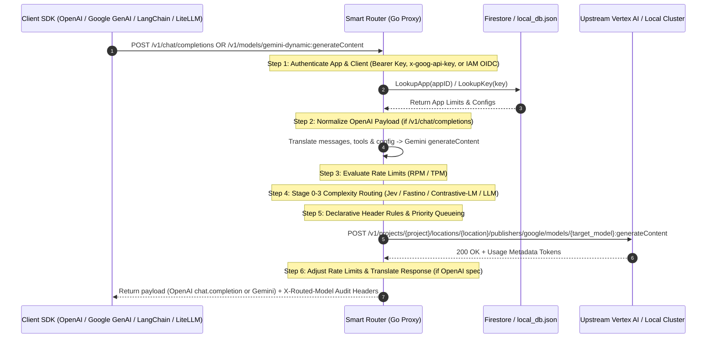

# 🗺️ Google GenAI & OpenAI SDK Coverage vs. Smart Router Capabilities

This document provides a comprehensive technical matrix comparing the capabilities of the official **Google GenAI SDK** (`google-genai` in Python, Node.js) and the **OpenAI SDK / Ecosystem** (`openai`, `langchain-openai`, `litellm`) against the native processing, interception, and routing capabilities of the **Smart Router**.

---

## 📊 Compatibility Matrix

The table below outlines how SDK calls map to the Smart Router, including support status, telemetry/rate-limiting support, and integration details.

| SDK Namespace / Feature | Go Proxy API Endpoint | Status | Rate Limiting (RPM/TPM) | Complexity Routing (`gemini-dynamic`) | Technical Details & Caveats |
| :--- | :--- | :--- | :--- | :--- | :--- |
| **Google GenAI `models.generate_content`** | `POST /v1/models/*:generateContent` | **Full** | Yes (Full adjustment) | Yes | Intercepted, token counts adjusted in post-request `ModifyResponse` callback. |
| **Google GenAI `models.generate_content_stream`** | `POST /v1/models/*:streamGenerateContent` | **Full** | Yes (Base limit) | Yes | Request/response streams successfully via SSE (including Direct Endpoints). |
| **Google Gemini Decisions API (`decisions.create`)** | `POST /v1beta/decisions` & `POST /v1/decisions` | **Full** | Yes (0 output tokens) | Native Engine (`gemini-decision-1`) | Authenticated via App API key or OIDC, scrubs caller keys, attaches keyless ADC OAuth2 + `x-goog-user-project`, and forwards to `generativelanguage.googleapis.com/v1beta/decisions`. |
| **OpenAI `chat.completions.create`** | `POST /v1/chat/completions` & `POST /v1beta/openai/chat/completions` | **Full** | Yes (Full adjustment) | Yes | Translates OpenAI messages/tools into Vertex Gemini payload, runs full 4-stage complexity routing, and returns OpenAI `chat.completion` JSON + `X-Routed-Model` header. |
| **OpenAI Streaming (`stream=True`)** | `POST /v1/chat/completions` (`stream: true`) | **Full** | Yes (Base limit) | Yes | Translates upstream Gemini stream into standard OpenAI `chat.completion.chunk` SSE events terminated by `data: [DONE]`. |
| **OpenAI & GenAI `models.list` / `models.retrieve`** | `GET /v1/models` & `GET /v1/models/{id}` | **Full** | Authenticated | N/A | Returns OpenAI-compatible `{"object": "list", "data": [...]}` and single-model descriptors for `gemini-dynamic` and all active models. |
| **Structured Outputs (`response_format` / `responseSchema`)** | Inside `generateContent` / `chat/completions` | **Full** | Yes | Yes | Supports native Gemini `responseSchema` and OpenAI `json_object` / `json_schema` response formats. |
| **Function Calling & Tools (`tools`)** | Inside `generateContent` / `chat/completions` | **Full** | Yes | Yes | Intercepted across both Gemini and OpenAI specs. If `ForceComplexTools` is enabled, routes automatically to the configured complex target (e.g., `gemini-3.1-pro`). |
| **Multimodal (Images / Data URLs)** | Inside `generateContent` / `chat/completions` | **Full** | Yes | Yes | Supports Gemini `inlineData`/`fileData` and OpenAI `image_url` content parts. If `ForceComplexMultimodal` is enabled, routes to the complex model tier. |
| **System / Developer Instructions** | Inside `generateContent` / `chat/completions` | **Full** | Yes | Yes | Supports Gemini `systemInstruction` and OpenAI `system`/`developer` roles. |
| **`models.embed_content`** | `POST /v1/models/*:embedContent` | **Partial** | RPM Only | No | **Caveat:** TPM estimation `/ 4` is optimized for generation; embeddings bypass semantic token adjustments. |
| **`models.count_tokens`** | `POST /v1/models/*:countTokens` | **Full** | RPM Only | No | Rewritten to regional endpoint. Bypasses TPM limitations since no content is generated. |
| **`chats` (Multi-Turn Sessions)** | Uses `generateContent` or `chat/completions` | **Full** | Yes | Yes | Supports `X-Session-ID`, `X-Session-Turn`, and `X-Agent-Task` headers for session pinning and multi-turn escalation. |
| **`files.upload` (File API)** | `POST /v1beta/files` | **Unsupported** | No | No | **Gap:** Large file staging APIs target global upload hosts. Upload large files (>20MB) directly to Google Cloud Storage (`gs://`). |
| **`caches` (Context Caching)** | `POST /v1/cachedContents` | **Unsupported** | No | No | **Gap:** Context caching endpoints are not currently rewritten by the reverse proxy director. |

---

## 🧠 Core Architectural Interception Flow

The Smart Router intercepts standard HTTP client traffic generated by both the **Google GenAI SDK** and the **OpenAI SDK** (as well as LangChain and LiteLLM) by normalizing requests into the router's 4-stage evaluation pipeline.



---

## 🛠️ Integration Examples

### 1. OpenAI Python SDK (`openai`)

```python
from openai import OpenAI

client = OpenAI(
    api_key="YOUR_ROUTER_API_KEY",
    base_url="https://<your-router-service-url>/v1",
)

response = client.chat.completions.create(
    model="gemini-dynamic",
    messages=[
        {"role": "system", "content": "You are a helpful assistant."},
        {"role": "user", "content": "Explain Quantum Computing in one simple sentence."},
    ],
)

print(f"Routed Model: {response.model}")
print(f"Response: {response.choices[0].message.content}")
```

### 2. Google GenAI Python SDK (`google-genai`)

```python
from google import genai
from google.genai import types

client = genai.Client(
    api_key="YOUR_ROUTER_API_KEY",
    http_options={
        "api_endpoint": "https://<your-router-service-url>"
    },
)

response = client.models.generate_content(
    model="gemini-dynamic",
    contents="Explain Quantum Computing in one simple sentence.",
    config=types.GenerateContentConfig(
        http_headers={"X-Session-ID": "billing-service-prod"}
    ),
)

print(f"Response: {response.text}")
```

### 3. LangChain (`langchain-openai`) & LiteLLM (`litellm`)

```python
from langchain_openai import ChatOpenAI
import litellm

# LangChain
llm = ChatOpenAI(
    model="gemini-dynamic",
    api_key="YOUR_ROUTER_API_KEY",
    base_url="https://<your-router-service-url>/v1",
)
print(llm.invoke("Write a haiku about distributed systems.").content)

# LiteLLM
res = litellm.completion(
    model="openai/gemini-dynamic",
    api_base="https://<your-router-service-url>/v1",
    api_key="YOUR_ROUTER_API_KEY",
    messages=[{"role": "user", "content": "Hello via LiteLLM!"}],
)
print(res.choices[0].message.content)
```

---

## ⚠️ What is NOT Covered (Coverage Gaps & Limitations)

> [!WARNING]
> **COMPATIBILITY LIMITATIONS**:
> The Smart Router is designed for text, multimodal, tool-calling generation, and model discovery. The following namespaces are outside the proxy's scope:

### 🔴 Unsupported Namespaces
* **`files` Namespace (`client.files.upload`, `client.files.get`, etc.)**:
  * **Mitigation**: Stage files directly in Google Cloud Storage (GCS) buckets and pass reference URIs using `fileData` inside the content request body.
* **`caches` Namespace (`client.caches.create`, `client.caches.list`, etc.)**:
  * **Mitigation**: Call Vertex AI caching endpoints directly with native credentials rather than using the Smart Router proxy.
* **`tunings` Namespace (`client.tunings.create_tuned_model`)**:
  * **Mitigation**: Execute supervised fine-tuning jobs directly via Vertex AI Custom Training or the Vertex AI Tuning API.
