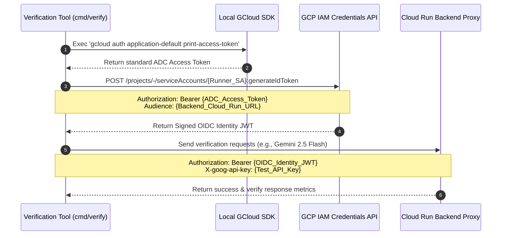

# 🚀 Cloud Run Deployment Guide

The Smart Router runs on **Google Cloud Run**. Deployment is automated using `deploy.sh` and Terraform.

---

## 📋 Google Cloud Project Prerequisites

If deploying to a new Google Cloud project:

1. **Enable Billing**: Link your project to an active Billing Account.
2. **Configure OAuth Consent Screen**: Go to **APIs & Services > OAuth consent screen**, select user type, and fill out the required fields.
3. **Enable Google Sign-In**: Go to **Identity Platform > Providers**, add **Google** as a provider, and enable it.

---

## 🔐 Step 1: Google Cloud CLI Authentication

Authenticate and configure the CLI project context:

```bash
gcloud auth login
gcloud config set project your-gcp-project-id
gcloud auth application-default login
gcloud auth application-default set-quota-project your-gcp-project-id
```

---

## 🔑 Step 2: Prepare the Environment File (`.env`)

1. Copy the sample environment template to `.env` if you haven't already:
   ```bash
   cp .env.sample .env
   ```

2. Open `.env` and configure the variables:
   * **Required User-Provided Variable**: Ensure `GOOGLE_CLOUD_PROJECT` is set to your GCP project ID.
   * **Firebase Web SDK Configurations**: **Leave them as the default placeholders!** During the deployment, `deploy.sh` will programmatically register your application with Firebase and automatically write the resolved credentials back to this `.env` file.
   * **Authorized Emails & Domains (Mandatory)**: Set `ALLOWED_EMAIL_DOMAINS` to configure dashboard admin logins (e.g., your domain or specific email address). There are no default authorized domains:
     ```ini
     ALLOWED_EMAIL_DOMAINS="mycompany.com,operator@gmail.com"
     ```

---

## 🚀 Step 3: Run the Deployment

Run the deployment script:

```bash
chmod +x deploy.sh
./deploy.sh
```

---

## 🔍 Deployment Steps Executed by `deploy.sh`

1. **Environment Checks**: Validates `.env` file variables.
2. **Firebase Provisioning**: Programmatically checks, links Firebase if necessary, registers the Web App, and updates `.env` with client SDK details.
3. **Infrastructure & Secret Manager Containers (Terraform)**:
   * Enables APIs (`run.googleapis.com`, `firestore.googleapis.com`, `secretmanager.googleapis.com`, `iam.googleapis.com`, `monitoring.googleapis.com`, `identitytoolkit.googleapis.com`, `aiplatform.googleapis.com`, `generativelanguage.googleapis.com`, and `apikeys.googleapis.com` for ADC-backed authorization key resolution against the Gemini Decisions API).
   * Provisions Firestore in Native mode and configures IAM Roles.
   * Provisions `google_secret_manager_secret` containers (`JEV_API_KEY`, `FASTINO_API_KEY`, `CLM_API_KEY`, `BACKEND_SHARED_SECRET`) and grants `roles/secretmanager.secretAccessor` to the Cloud Run service account **without** reading `.env` or storing secret values in `terraform.tfstate`.
4. **Out-of-Band Secret Sync & Upstream Auth**:
   * Vertex AI / Gemini upstream inference uses Google Cloud Application Default Credentials (ADC).
   * Optional decision engine and shared secret values (`JEV_API_KEY`, `FASTINO_API_KEY`, `CLM_API_KEY`, `BACKEND_SHARED_SECRET`) present in `.env` are synced directly to Google Cloud Secret Manager via `gcloud secrets versions add --data-file=-` and mounted into Cloud Run via `enabled_secret_mounts` (`value_source.secret_key_ref`).
5. **Compilation & Deployment**:
   * Compiles HTML templates with `templ`.
   * Triggers Cloud Build to deploy Backend and Frontend services to Cloud Run.
6. **Verification Tests**:
   * Runs `go run cmd/verify/main.go` against the backend to test functionality (requests routing, security boundary, and rules engine).
   * Cleans up test records from Firestore.

---

## 🔐 Service Accounts & Admin API OIDC Pinning

Each Cloud Run service runs as its own least-privilege service account (defined in `terraform/service-accounts.tf`):

| Service | Service account | Roles (scope) |
| --- | --- | --- |
| `gemini-smart-router` (backend) | `smart-router-api-sa` | `roles/aiplatform.user`, `roles/datastore.user`, `roles/serviceusage.serviceUsageConsumer`, `roles/serviceusage.apiKeysViewer` (project); `roles/secretmanager.secretAccessor` on `BACKEND_SHARED_SECRET` + mounted decision secrets |
| `gemini-smart-router-ui` | `smart-router-ui-sa` | `roles/firebaseauth.admin`, `roles/aiplatform.user`, `roles/logging.viewer`, `roles/serviceusage.serviceUsageConsumer`, `roles/serviceusage.apiKeysViewer` (project); `roles/secretmanager.secretAccessor` on `BACKEND_SHARED_SECRET`; `roles/run.invoker` on the backend |
| `gemini-traffic-generator` | `smart-router-traffic-sa` | `roles/run.invoker` on the backend only |

`gemini-router-runner` no longer runs any Cloud Run service. It is kept as the identity operators impersonate to mint OIDC tokens for `cmd/verify` (and for an existing GKE Workload Identity binding), and it keeps `roles/run.invoker` on the backend.

The backend admin API (`/api/*`) accepts either the shared secret (`X-Shared-Secret`) or a Google OIDC ID token. OIDC tokens are accepted only when **both** of these backend env vars are set (otherwise OIDC is rejected, fail closed):

| Env var | Value |
| --- | --- |
| `API_OIDC_AUDIENCES` | Comma-separated backend URLs the token `aud` must match, e.g. `https://gemini-smart-router-<hash>-uc.a.run.app,https://gemini-smart-router-<project-number>.us-central1.run.app` |
| `API_ALLOWED_CALLERS` | Comma-separated service-account emails allowed to call the admin API, e.g. `smart-router-ui-sa@<project>.iam.gserviceaccount.com,gemini-router-runner@<project>.iam.gserviceaccount.com` |

The token's `email` claim must be in `API_ALLOWED_CALLERS` and `email_verified` must be `true`. A token minted for any other audience returns `401`.

---

## 🛡️ Post-Deployment Secure Verification & Token Impersonation

The Smart Router backend on Cloud Run is publicly invokable (`allUsers` has `roles/run.invoker`, see `google_cloud_run_v2_service_iam_member.public_access`) because it is a hybrid API gateway: client traffic is authenticated inside the app by API keys, and the admin REST API (`/api/*`) is authenticated by the shared secret or by an OIDC identity token whose audience is the backend service URL and whose caller is in `API_ALLOWED_CALLERS` (see above). The caller service accounts also hold `roles/run.invoker` on the backend directly, so they keep working if the `allUsers` binding is ever removed.

Since standard user accounts (e.g., `@mycompany.com` or `@gmail.com` accounts logged in via `gcloud`) cannot generate custom-audience OIDC tokens directly, the post-deployment verify utility (`cmd/verify/main.go`) implements a robust **ADC-Driven Service Account Impersonation** pattern.

### 🔄 Authentication & Verification Flow



### 🛠️ Running Verification Tests Manually

If you need to run the verification tests manually from your local terminal against the active Cloud Run backend service:

1. **Ensure ADC Credentials are Active**:
   ```bash
   gcloud auth application-default login
   gcloud config set project your-gcp-project-id
   ```

2. **Retrieve your Backend Service URL**:
   ```bash
   export SERVICE_URL=$(gcloud run services describe gemini-smart-router --region us-central1 --format="value(status.url)")
   ```

3. **Execute the Verification Suite**:
   ```bash
   SERVICE_URL=$SERVICE_URL GOOGLE_CLOUD_PROJECT="your-gcp-project-id" go run cmd/verify/main.go
   ```

The utility will automatically retrieve the ADC access token, generate the signed identity token, configure mock client configurations in Firestore, verify standard and rules-based routing against real Gemini endpoints, and purge the test data upon completion.

