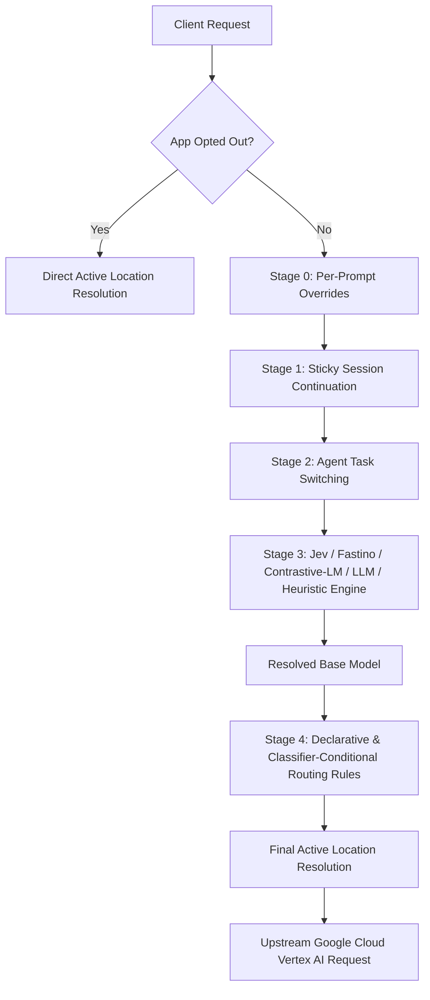

# 🧠 Routing Configuration & Auditing

The Smart Router provides **Fast Decision Model Routing (Jev, Fastino & Contrastive-LM)**, **Session Affinity**, **Agent Task Switching**, **Per-Prompt Overrides**, and **Conditional Rules-Based Routing** to manage Gemini API requests.

---

## 🚀 1. Complexity-Based & Fast Decision Routing (`gemini-dynamic`)

Clients can target the virtual model **`gemini-dynamic`** instead of hardcoding model names:

```http
POST http://localhost:8080/v1/models/gemini-dynamic:generateContent?key=gr_key_abc
```

### Decision Engines
The router supports five decision engines to classify prompt complexity into `simple`, `medium`, or `complex` tiers:
* **`jev` (Jev Structured Decision Model)**: Microsecond rule-based logit scoring over extracted syntactic and structural features (code blocks, math/O-notation, multi-step reasoning, and word count), with optional remote `/v1/systemone` or flat JSON endpoint evaluation (`JevEndpoint` / `JEV_ENDPOINT`).
* **`fastino` (Fastino GLiClass / Pioneer Classifier)**: Sub-millisecond zero-shot sequence classification via a remote Fastino endpoint (`FastinoEndpoint` / `FASTINO_ENDPOINT`) or local zero-shot structural density fallback.
* **`contrastive-lm` / `clm` (Contrastive-LM Embedding Classifier)**: 5D Euclidean contrastive distance classifier comparing prompt feature vectors against Simple, Medium, and Complex anchor profiles, with support for a self-hosted Contrastive-LM cluster runner (`CLMEndpoint` / `CLM_ENDPOINT` on `/rank` or `/classify`) or local Euclidean fallback.
* **`llm` (LLM Semantic Classifier)**: Dispatches the prompt to a lightweight foundation model (`gemini-3.5-flash-lite`) for deep semantic classification.
* **`heuristics` (Static Bounds)**: Character length and multimodal/tool boundary checks.

### Contrastive-LM Cluster Setup & Global Provider Registry
Unlike external managed APIs (`jev`, `fastino`), **Contrastive-LM (`contrastive-lm`)** is typically deployed as an internal cluster runner (vLLM, TEI, or custom embedding scorer on GKE, Cloud Run internal ingress, or K8s `.svc.cluster.local`) or bound to a registered **Direct Endpoint** (`provider_type: "contrastive-lm"`, `role: "decision_engine"`):
* **Global Provider & Cluster Registry (`DecisionProviders`)**: Administrators can configure global endpoints, connection modes (`cluster_internal`, `remote_api`, or `local_fallback`), and Direct Endpoint cluster bindings (`ClusterID`) across `/admin/complexity` or `/admin/clusters` without duplicating URLs on every individual Application.
* **Private Cluster SSRF Whitelisting**: The decision engine HTTP validator allows RFC1918 private VPC subnets (`10.0.0.0/8`, `172.16.0.0/12`, `192.168.0.0/16`) and internal cluster DNS suffixes (`.svc.cluster.local`, `.internal`, `.local`) while strictly blocking cloud metadata (`169.254.169.254`), loopback (`127.0.0.0/8`), and link-local addresses.
* **Live Provider Connection Probe**: Use the **Test Connection** button in `/admin/complexity` (`POST /admin/complexity/providers/probe` / `POST /api/decision/providers/probe`) to run a live complexity classification probe against any configured engine and inspect its latency, resolved tier, confidence, and connection mode.

### Custom Tier Criteria & Confidence Thresholds
Per application, administrators can configure:
* **Custom Tier Criteria (`SimpleCriteria`, `MediumCriteria`, `ComplexCriteria`)**: Comma-separated keywords or domain phrases that boost logit/similarity scores for their respective tier across `jev`, `fastino`, and `contrastive-lm`.
* **Minimum Confidence Threshold (`MinConfidence`)**: If the decision engine's confidence falls below `MinConfidence` (e.g., `0.75`), the router automatically escalates `simple` -> `medium` and `medium` -> `complex` (`[min_confidence_fallback: ...]`) to prevent under-provisioning on ambiguous prompts.

### Secret Key Management (`.env` → `deploy.sh` → Google Cloud Secret Manager)
Remote decision engine endpoints (`jev`, `fastino`, `contrastive-lm`) and internal administrative calls (`BACKEND_SHARED_SECRET`) use a unified zero-leak secret pipeline:
1. **Local Development (`.env` Auto-Loader)**: When running outside Cloud Run (`K_SERVICE == ""`), `decision.LoadDotEnv()` automatically parses the gitignored `.env` file on startup (`JEV_API_KEY`, `FASTINO_API_KEY`, `CLM_API_KEY`, `JEV_ENDPOINT`, `FASTINO_ENDPOINT`, `CLM_ENDPOINT`, `BACKEND_SHARED_SECRET`) without overwriting existing process environment variables. `GetEngineSecretStatus` reports `source: "dotenv"`.
2. **Production Deployment (`terraform/` & `./deploy.sh`)**: Terraform provisions empty `google_secret_manager_secret` containers (`JEV_API_KEY`, `FASTINO_API_KEY`, `CLM_API_KEY`, `BACKEND_SHARED_SECRET`) and IAM bindings (`roles/secretmanager.secretAccessor`) without ever reading `.env` or writing plaintext secret versions into `terraform.tfstate`. During deployment, `./deploy.sh` populates secret versions out-of-band via `gcloud secrets versions add --data-file=-` and passes active secret names via `-var="enabled_secret_mounts=..."` so Cloud Run mounts them via `value_source.secret_key_ref` (`--set-secrets`). On Cloud Run (`K_SERVICE != ""`), `GetEngineSecretStatus` reports `source: "secret_manager"`.
3. **Runtime Admin Sync (Frontend ↔ Backend)**: Saving or deleting provider credentials, endpoints, or Contrastive-LM cluster bindings in `/admin/complexity` immediately persists to `ConfigStore` (`DecisionProviders`) and syncs to the backend proxy via `POST|DELETE /api/v1/complexity/keys`. API responses and UI badges always mask keys (e.g., `sk-...6789`).


### Tier-to-Model Mapping
* **Simple prompts** (short text, greetings, quick lookups, triage) -> Routed to `gemini-3.5-flash-lite` (lowest cost and latency).
* **Medium prompts** (standard summarization, translations, content generation) -> Routed to `gemini-3.8-flash` (balanced high performance).
* **Complex prompts** (deep code generation, debugging, algorithmic math, multimodal payloads, or tool calls) -> Routed to `gemini-3.1-pro` (highest reasoning capacity).

---

## 🎯 2. Per-Prompt Overrides, Session Continuation & Agent Task Switching

### Per-Prompt Overrides (Stage 0)
Clients can override dynamic routing per prompt using HTTP request headers:
* **`X-Router-Model`**: Immediately pin the target model for this single prompt (e.g., `X-Router-Model: gemini-3.1-pro`).
* **`X-Router-Complexity`**: Force a specific complexity tier (`simple`, `medium`, or `complex`) mapped to the app's configured models.
* **`X-Router-Engine`**: Select the decision engine (`jev`, `fastino`, `contrastive-lm`, `clm`, `llm`, or `heuristics`) for this prompt.

### Sticky Multi-Turn Session Continuation (Stage 1)
To preserve reasoning continuity across multi-turn conversations, pass a session identifier:
* **`X-Session-ID`**: Unique conversation/session identifier (e.g., `X-Session-ID: sess-chat-42`).
* **`X-Session-Policy`**: Set to `lock` (default when session ID is provided) to lock the session to the model selected on the first turn, or `adaptive` to re-evaluate complexity on each turn while tracking turn count.

### Autonomous Agent Task Switching (Stage 2)
Autonomous agents can dynamically change the model tier mid-session or per request based on their current task:
* **`X-Agent-Task`** (or **`X-Task-Kind`**): Specify the task kind:
  * **Complex Tier (`gemini-3.1-pro`)**: `code_generation`, `coding`, `debugging`, `architecture`, `deep_reasoning`, `math`, `security_audit`, `refactoring`
  * **Medium Tier (`gemini-3.8-flash`)**: `summarization`, `translation`, `analysis`, `data_extraction`, `writing`, `explanation`, `chat`
  * **Simple Tier (`gemini-3.5-flash-lite`)**: `triage`, `classification`, `formatting`, `greeting`, `routing`, `fast_query`, `validation`
* When combined with `X-Session-ID`, sending a new `X-Agent-Task` updates the session's active task and switches the locked model to match the new task tier.

### REST API for Session, Keys, Providers & Explainability Management
* `GET /api/v1/sessions` — List active multi-turn sessions or fetch a session by `?id=<session_id>`.
* `POST /api/v1/sessions/task` — Dynamically update an active session's task, model, or policy.
* `POST /api/v1/sessions/reset` — Reset or clear a locked session.
* `POST /api/v1/complexity/inspect` — Inspect prompt features, tier logits, target model, and human-readable decision rationales across `jev`, `fastino`, `contrastive-lm`, or `heuristics` without invoking upstream inference.
* `GET|POST|DELETE /api/v1/complexity/keys` — Inspect masked key & provider status (`providers` + `keys`), store/rotate runtime decision engine API keys, endpoints, and Contrastive-LM cluster bindings, or clear keys from the runtime vault.
* `GET /api/decision/providers` & `POST /api/decision/providers/probe` — Inspect decision engine provider status or run a live classification probe against `jev`, `fastino`, or `contrastive-lm`.

---

## ⚙️ 3. Declarative & Classifier-Conditional Routing Rules

Enforce overrides based on Client tier, Application ID, custom HTTP headers, or live decision engine classification outputs (`decision_engine`, `complexity_tier`, `min_confidence`, and `task_kind`).

### Routing Rules Example (Classifier-Conditional)
Route any request classified by `fastino` as `complex` with at least `0.70` confidence during a `security_audit` task to `gemini-3.1-pro`:
```json
{
  "id": "rule-fastino-complex-security",
  "model_pattern": "*",
  "app_id": "all",
  "client_tier": "premium",
  "decision_engine": "fastino",
  "complexity_tier": "complex",
  "min_confidence": 0.70,
  "task_kind": "security_audit",
  "target_model": "gemini-3.1-pro",
  "target_location": "us",
  "fallback_model": "gemini-3.8-flash",
  "priority_weight": 10
}
```
> [!NOTE]
> Even if a client sends a direct model request (instead of `gemini-dynamic`), Stage 4 automatically triggers on-demand classifier evaluation if a candidate routing rule specifies `decision_engine`, `complexity_tier`, or `min_confidence`.

---

## 🔄 4. The Dynamic Routing Pipeline & Execution Order

The Smart Router manages request routing in a sequential multi-stage pipeline:



### 🚫 Complete Application Opt-Out
If a particular Application requires static, untouched routing behavior, administrators can toggle **Opt Out of Dynamic Routing** inside the application's configuration modal:
* All dynamic complexity stages and declarative routing rules will be bypassed entirely.
* The request will be forwarded to the target location matching the client's requested model.

---

## 🌐 5. Regional Routing Compatibility

The Smart Router steers traffic using regional levels:
1. **Specific regions** (e.g., `us-central1`) - Level 1 (Smallest)
2. **Multi-regions** (e.g., `us`, `eu`) - Level 2
3. **Global** (`global`) - Level 3 (Broadest)

* If the router is in `us-central1` and the model is at `us`, the proxy routes to `us`.
* If the model is in `us-central1` and the router is in `us`, the proxy routes to `us-central1`.
* Incompatible routes (e.g., EU router to a strictly US model) are blocked unless overridden.

### Smart Location Resolution
When a model is requested or dynamic complexity selects a base model (e.g., `gemini-3.8-flash`):
* The router automatically looks up the enabled/active option in order of regional specificity relative to the router's location:
  1. **Local region** (e.g., `gemini-3.8-flash@us-central1`)
  2. **Parent multi-region** (e.g., `gemini-3.8-flash@us`)
  3. **Global** (e.g., `gemini-3.8-flash@global`)

---

## 📊 6. Auditing & Monitoring

The Smart Router adds custom audit headers on all proxied HTTP responses:

| HTTP Response Header | Description | Example |
| :--- | :--- | :--- |
| **`X-Requested-Model`** | Model requested by the client | `gemini-dynamic` |
| **`X-Routed-Model`** | Upstream model targeted | `gemini-3.1-pro` |
| **`X-Routed-Model-Location`** | Resolved serving location | `us` |
| **`X-Router-Engine-Used`** | Decision engine or stage that resolved the model | `jev`, `clm`, `session_lock`, `task_mapping`, `prompt_override` |
| **`X-Router-Complexity-Tier`** | Assigned complexity tier | `simple`, `medium`, `complex` |
| **`X-Session-ID`** | Active multi-turn session ID (if present) | `sess-chat-42` |
| **`X-Session-Turn`** | Current conversation turn index in the session | `2` |
| **`X-Agent-Task`** | Active agent task context (if present) | `debugging` |
| **`X-Client-Tier`** | Client subscription tier | `premium` |
| **`X-App-ID`** | Calling Application ID | `customer-facing-bot` |

### Example Response
```http
HTTP/1.1 200 OK
Content-Type: application/json
X-Requested-Model: gemini-dynamic
X-Routed-Model: gemini-3.1-pro
X-Router-Engine-Used: jev
X-Router-Complexity-Tier: complex
X-Session-ID: sess-chat-42
X-Session-Turn: 1
X-Client-Tier: standard
X-App-ID: mobile-chat-app
```


---

## ⏳ 5. Adaptive Throttling & Queueing Pipeline (429 Handling)

To protect upstream Vertex AI quotas and guarantee high-priority traffic delivery, the Smart Router operates a dynamic backpressure queue.

### Overload Detection
* When any upstream model request returns an HTTP `429 Too Many Requests` (after exhausted retries and exponential backoffs), the router automatically flags that specific model as **Overloaded**.
* The overloaded status initiates a cooldown period (default 15 seconds).

### Pipeline Execution & Prioritization
* **Healthy Models**: Requests are submitted immediately for execution if global router concurrency capacity is available (`ROUTER_CONCURRENCY_LIMIT`).
* **Overloaded Models**:
  * Concurrency to the overloaded model is restricted (default max 1 concurrent check).
  * All other concurrent incoming requests for that model are immediately enqueued in the **Priority Queue**.
  * The Priority Queue sorts requests using App priority and Client tier (`PriorityValue`):
    * **High Priority** (RPM/TPM rate bounds, e.g., `high` priority App) gets executed first.
    * **Client Tier** acts as the tiebreaker (e.g., `premium` tier Client preceding `free` tier).
    * **FIFO** (First-In, First-Out) is applied for identical priority values.
  * If an active check succeeds (returns 200 OK), the overloaded status is cleared immediately, and the queue dispatches held requests at full speed.

### Real-Time Queue Dashboard
View the active and queued request list dynamically inside the **Request Queue** tab (`/admin/queue`) in the administrative panel. The pipeline stats and tables auto-refresh every 2 seconds via HTMX.
